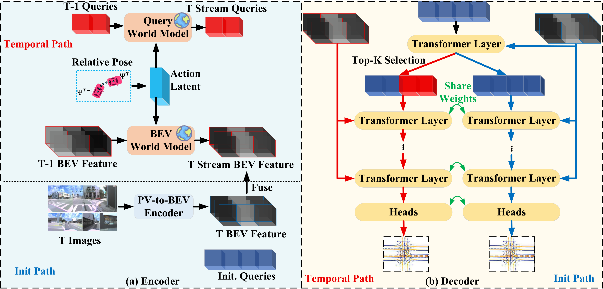

<div align="center">

<h1>DualTopo</h1>

<p><strong>Spatio-Temporal Lane Segment Graph Generation with Dual Latent World Models and Parallel Query Supervision</strong></p>

<p>
  <a href="https://yimingyang23.github.io/">Yiming Yang</a><sup>1</sup>&emsp;
  <a href="https://scholar.google.com/citations?user=LqX1k5QAAAAJ&amp;hl=zh-CN&amp;oi=ao">Hongbin Lin</a><sup>1</sup>&emsp;
  <a href="https://scholar.google.com/citations?user=B588EyYAAAAJ&amp;hl=zh-CN&amp;oi=ao">Yueru Luo</a><sup>1</sup>&emsp;
  <a href="https://scholar.google.com/citations?user=jwPyH6wAAAAJ&amp;hl=zh-CN">Suzhong Fu</a><sup>1</sup>&emsp;
  <a href="https://scholar.google.com/citations?user=6A1yEFMAAAAJ&amp;hl=zh-CN&amp;oi=ao">Chao Zheng</a><sup>3</sup><br>
  Xinrui Yan<sup>3</sup>&emsp;
  Kun Tang<sup>3</sup>&emsp;
  <a href="https://lvchen.wixsite.com/automan">Chen Lv</a><sup>2</sup>&emsp;
  <a href="https://sse.cuhk.edu.cn/en/faculty/cuishuguang">Shuguang Cui</a><sup>1</sup>&emsp;
  <a href="https://sse.cuhk.edu.cn/faculty/lizhen">Zhen Li</a><sup>1</sup>
</p>

<p>
  <sup>1</sup>The Chinese University of Hong Kong, Shenzhen<br>
  <sup>2</sup>Nanyang Technological University&emsp;
  <sup>3</sup>Tencent Maps (T Lab)
</p>

<p>
  <a href="https://www.cuhk.edu.cn/"></a>&ensp;
  <a href="https://www.ntu.edu.sg/"></a>&ensp;
  <a href="https://map.qq.com/"></a>
</p>

</div>

## Overview

DualTopo reconstructs lane geometry and connectivity from multi-view camera sequences. Query and BEV world models propagate temporal context, a shared dual-pathway decoder predicts from current and historical queries, and directed graph propagation carries lane connectivity across frames.



## Model Zoo

### DualTopo: SubsetA lane segments

[PyTorch implementation](projects/dualtopo/README.md) · [Checkpoint](https://huggingface.co/y352184741/DualTopo/blob/main/dualtopo_remake_scale025_subset_a.pth)

Results on 4,806 validation frames (%).

| Branch | mAP | AP_ls | AP_ped | TOP_lsls | mAP_type |
| --- | ---: | ---: | ---: | ---: | ---: |
| Init | 36.94 | 35.18 | 38.69 | 28.45 | 50.49 |
| Temporal | 40.47 | 39.53 | 41.42 | 32.11 | 53.85 |

### RATopo: SubsetA / SubsetB centerlines

[MMCV implementation](projects/ratopo/README.md) · [SubsetA checkpoint](https://huggingface.co/y352184741/DualTopo/tree/main/ratopo_subset_a) · [SubsetB checkpoint](https://huggingface.co/y352184741/DualTopo/tree/main/ratopo_subset_b)

Results on 4,806 SubsetA and 6,019 SubsetB validation frames (%).

| Subset | Branch | OLS | DET_l | DET_t | TOP_ll | TOP_lt |
| --- | --- | ---: | ---: | ---: | ---: | ---: |
| A | Single-frame | 48.65 | 31.22 | 49.77 | 31.88 | 32.64 |
| A | Temporal | 50.14 | 33.48 | 49.77 | 34.71 | 34.08 |
| B | Single-frame | 53.65 | 39.56 | 56.73 | 42.82 | 27.93 |
| B | Temporal | 54.97 | 41.48 | 56.73 | 45.88 | 29.10 |

SubsetA centerline evaluation converts five polygonal traffic-element annotations to native bounding boxes. See the evaluation protocols for [SubsetA](projects/ratopo/backends/subset_a/results.json) and [SubsetB](projects/ratopo/backends/subset_b/results.json).

## Getting Started

```bash
git clone https://github.com/YimingYang23/DualTopo.git
cd DualTopo
```

Choose the implementation for your task and install it in its own environment.

| Project | Environment | Dataset / task |
| --- | --- | --- |
| [DualTopo](projects/dualtopo/README.md) | Python 3.11 · PyTorch 2.6 · Transformers | SubsetA lane segments, LaneSegNet format |
| [RATopo](projects/ratopo/README.md) | Python 3.8 · PyTorch 1.9 · MMCV 1.5.2 | SubsetA 3D / SubsetB 2D centerlines |

Each project README covers installation, data preparation and evaluation. Its `tools/reproduce.py` command downloads the weights, runs inference and computes official metrics.

## Acknowledgements and License

This project builds on [LaneSegNet](https://github.com/OpenDriveLab/LaneSegNet), [RATopo](https://github.com/buaa-colalab/RATopo) and [OpenLane-V2](https://github.com/OpenDriveLab/OpenLane-V2).

[Apache-2.0 license](LICENSE) · [Third-party notices](NOTICE) · [Previous release](https://github.com/YimingYang23/DualTopo/tree/legacy-layout-20261029)
