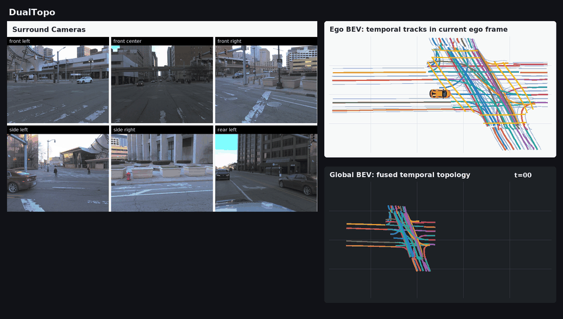
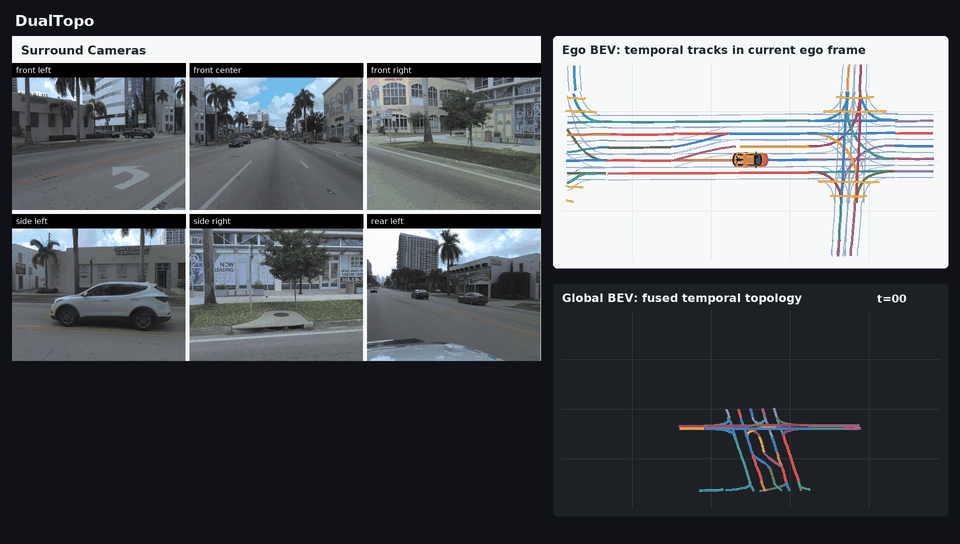
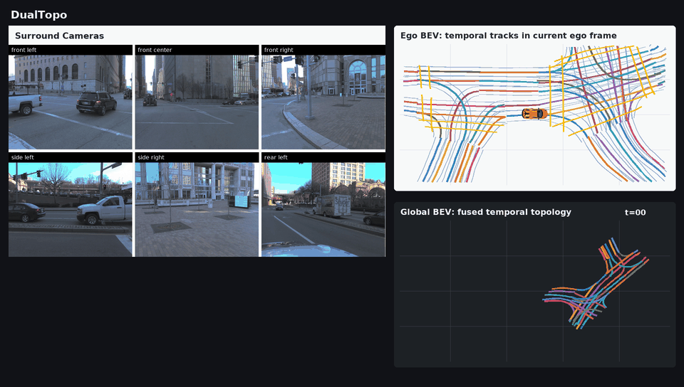

# DualTopo — SubsetA inference

**DualTopo: Spatio-Temporal Lane Segment Graph Generation with Dual Latent World Models and Parallel Query Supervision**

This repository releases inference for the **Remake + directed topology memory, residual scale 0.25** checkpoint on **OpenLane-V2 SubsetA**. It uses PyTorch without MMCV, MMDetection or MMDetection3D. Only inference, installation and data-interface documentation are included.

## Visualizations

Three animated examples show surround-camera views, temporal lane tracks in the current ego frame, and fused topology in the global BEV. The original GIFs are preserved.

**Example 1**



**Example 2**



**Example 3**



## Quick start

Follow [installation](docs/installation.md) and [SubsetA data preparation](docs/data.md), then:

```bash
python tools/download_weights.py --directory weights

python tools/infer.py \
  --checkpoint weights/dualtopo_remake_scale025_subset_a.pth \
  --data-root data \
  --annotations data/OpenLane-V2/data_dict_subset_A_val_lanesegnet.pkl \
  --output outputs/subset_a_temporal.pkl \
  --branch temporal
```

The [model repository](https://huggingface.co/y352184741/DualTopo) hosts the released [SubsetA checkpoint](https://huggingface.co/y352184741/DualTopo/blob/main/dualtopo_remake_scale025_subset_a.pth). The download tool verifies its SHA-256 against `configs/weights.json`. See [weight details](docs/weights.md) for the export format and provenance.

Use `--branch init` for the paper's **init pathway**. Both pathways use the same checkpoint and shared decoder; the init pathway is an output selection, not a separately trained baseline. Frames remain sequential in both modes. `--limit 2 --workers 0` runs a short prefix for debugging; omit `--limit` for full inference. Do not shuffle frames or split individual frames across independent workers with separate temporal state.

## Names used in the paper

| Paper component | Public implementation |
| --- | --- |
| DualTopo | `dualtopo.DualTopo` |
| QueryWorldModel (QWM) | `dualtopo.QueryWorldModel`, `lane_head.query_world_model` |
| BEVWorldModel (BWM) | `dualtopo.BEVWorldModel`, `lane_head.bev_world_model` |
| Dual-Pathway Decoder | `dualtopo.DualPathwayDecoder` |
| Directed graph propagation, Eq. (6) | `dualtopo.DirectedGraphPropagation` |
| Query/BEV history and directed topology memory | scene-aware buffers in `dualtopo/memory_buffer.py` |

QWM and BWM condition latent state prediction on the relative ego transformation. The shared decoder produces init and temporal predictions. Directed graph propagation uses ordered raw Top-K adjacency, separate predecessor/successor projections, a confidence gate and **λ = 0.25**. Read [inference semantics](docs/inference.md) for state reset and geometry details.

## Released configuration

| Setting | Value |
| --- | --- |
| Dataset | OpenLane-V2 SubsetA |
| Image encoder | ResNet-50 + FPN, seven cameras |
| BEV / hidden dimension | 100 × 200 / 256 |
| Candidate queries / retained history | 200 / 66 |
| Lane segment geometry | 10 XYZ points per centerline, left boundary and right boundary; 90 coordinates |
| Directed memory residual | 0.25 |
| Checkpoint | epoch 12, iteration 33516 |
| Export format | model tensors + portable metadata; no optimizer state |

The public configuration is `configs/dualtopo_remake_scale025_subset_a.json`. Dataset files and model binaries are distributed separately. This release does not include SubsetB or training entry points. It exports raw learned topology; output-only geometric topology reweighting is not enabled.

## Output

`tools/infer.py` writes a LaneSegNet-compatible prediction pickle and a JSON receipt containing the frame count, branch and file hashes. Each frame contains lane segments, pedestrian-crossing areas and directed `topology_lsls`. This checkpoint has no traffic-element detector; traffic-element output is empty.

## Validation and attribution

The release preserves all **1,023** checkpoint tensors exactly under explicit name mapping. CPU fixtures verified identical first-frame and history-frame QWM/BWM, decoder, directed graph and native-format predictions against the accepted implementation. These fixtures are compatibility checks, not a fresh full-dataset benchmark. See [release validation](docs/validation.md).

The lane representation, preprocessing and parts of the inference layers derive from [LaneSegNet](https://github.com/OpenDriveLab/LaneSegNet) and the BEVFormer-based streaming implementation. Third-party attribution is retained in [NOTICE](NOTICE); code is distributed under [Apache-2.0](LICENSE). The OpenLane-V2 dataset remains subject to its own terms.
